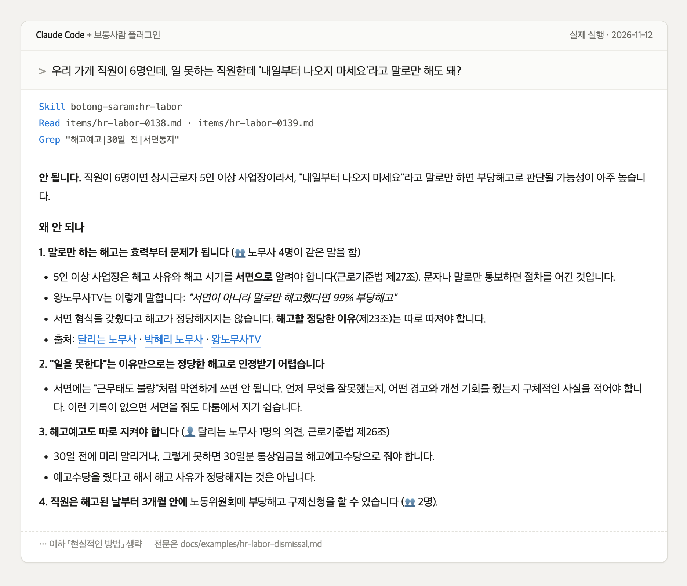
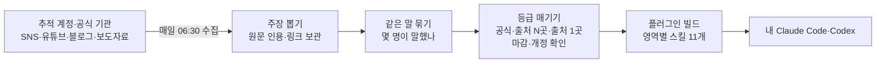

# 보통사람

**요즘 보통사람이라면 이 정도는 알아요.**

업계 인플루언서·실무자·공식 기관이 SNS와 블로그에서 *반복해서 하는 말*을 사람별로 모아, Claude Code·Codex 플러그인으로 매일 배포합니다. 소규모 사업자가 AI에게 마케팅·노무·세무·인허가를 물으면, 답에 **누가, 몇 명이 그렇게 말했는지**와 원문 출처가 함께 붙습니다.

👉 **[플러그인 현황판](https://n7business.github.io/botong-saram/)** — 영역별로 무엇이 실렸는지, 오늘 무엇이 새로 들어왔는지

만든 곳: 강남 역삼동 공유오피스·커뮤니티 **[역삼836](https://yeoksam836.com/?utm_source=github&utm_medium=readme&utm_campaign=botong)** — Claude Code 강의와 만드는 사람들의 모임을 엽니다.



위 화면은 2026-11-12 실제 실행 결과입니다. 답 전문은 [docs/examples/hr-labor-dismissal.md](docs/examples/hr-labor-dismissal.md).

## 설치

**Claude Code**
```
/plugin marketplace add n7business/botong-saram
/plugin install botong-saram@botong-saram
```
`/plugin` → Marketplaces → botong-saram → **Enable auto-update**를 한 번 켜 두면 세션을 열 때마다 새 내용을 받습니다.

**Codex**
```
codex plugin marketplace add n7business/botong-saram
```

설치한 뒤에는 평소처럼 물어보면 됩니다. 예: "직원 6명인데 연장근로수당 꼭 줘야 해?", "스마트스토어 상세페이지 요즘 어떻게 만들어?", "이번 달 마감인 정부지원사업 있어?"

다른 플러그인을 아주 많이 깔아 두었다면 Claude가 보통사람 스킬을 못 고를 때가 있습니다. 그럴 땐 질문 앞에 **"보통사람 기준으로"**를 붙이면 확실히 엽니다.

**그 밖의 에이전트(Cursor·Gemini CLI 등)** — 스킬만 따로 설치: `npx skills add n7business/botong-saram`

### 이 플러그인이 하는 일
- 설치된 마크다운 파일(SKILL.md·all.md·people.md·items/)을 읽기만 합니다. 훅·MCP 서버·실행 스크립트가 없고, 어떤 정보도 밖으로 보내지 않습니다.
- 빌드일이 7일 넘게 지났고 웹을 읽을 수 있으면, 최신본 `raw.githubusercontent.com/n7business/botong-saram/main/plugin/skills/<영역>/SKILL.md`를 읽도록 안내되어 있습니다.

## 들어 있는 것

<!-- stats:start -->
2026-11-19 기준 **3,538건** · 추적 출처 167곳 · 최근 7일 새로 들어온 항목 946건 (매일 자동 갱신, ⚖️ 법령 영역)

| 영역 | 항목 | 🏛 공식 | 👥 출처 여러 곳 | 👤 출처 1곳 | 최근 7일 신규 |
|---|--:|--:|--:|--:|--:|
| 마케팅·홍보·디자인 | 559 | 142 | 4 | 413 | 144 |
| 사업화·매출 증대 | 423 | 75 | 3 | 345 | 138 |
| 매출·경영 지표 | 137 | 13 | 1 | 122 | 1 |
| 생산·현장 AX | 226 | 59 | 1 | 166 | 79 |
| 행정·인허가 ⚖️ | 219 | 196 | 0 | 23 | 95 |
| 사업계획서·정부지원 | 465 | 151 | 11 | 303 | 140 |
| AI 도구·트렌드 | 569 | 129 | 18 | 422 | 104 |
| 인사·노무 ⚖️ | 175 | 36 | 21 | 107 | 18 |
| 세무 ⚖️ | 242 | 64 | 5 | 157 | 85 |
| 기본법 ⚖️ | 348 | 176 | 3 | 154 | 118 |
| 창업자 마인드·습관 | 175 | 0 | 2 | 173 | 24 |
<!-- stats:end -->

## 등급 — 검증은 문턱이 아니라 표시입니다

모든 항목을 싣되, 출처가 몇 곳인지를 붙입니다. AI는 등급에 맞춰 말투를 바꿉니다. **등급은 주장에 붙는 자료 수·상태 표시이고, 말한 분에 대한 평가가 아닙니다.**

| 등급 | 뜻 | AI가 전하는 방식 |
|---|---|---|
| 🏛 공식 발표 · 📚 연구·저서 | 정부·공공기관 발표, 법령, 책·논문 | 그대로 따른다 |
| 👥 출처 N곳 | 서로 다른 출처 2곳 이상이 같은 말을 함 | "업계에서 보통 이렇게 한다" |
| 👤 출처 1곳 | 아직 한 곳에서만 나옴 | "○○는 이렇게 말한다" |
| 🧪 실험 중 | 직접 검증하는 중 | 가설로 전한다 |
| ⚠️ 다시 확인 필요 | 법 개정·다른 주장과 충돌·재검토 기한 경과 | 먼저 경고한다 |
| ⛔ 이후 바뀜 | 말한 뒤 법·정책·사실이 달라져 지금은 맞지 않음(말한 분의 잘못이 아님) | 지금은 다르다고 경고한다 |

신청 마감이 지난 공고는 자동으로 빠집니다. 노무·세무·인허가·기본법 영역은 법령 개정을 주 1회 대조하며, 개별 사안은 전문가 확인이 필요합니다.

## 어떻게 만들어지나



## 역삼836에서 같이 배워요

보통사람은 역삼836이 만들고 매일 운영하며, 아래 강의와 커뮤니티를 소개합니다. **여기에 인용된 분들은 역삼836과 아무 관계가 없고, 역삼836의 강의·서비스를 보증하지 않습니다.** 플러그인을 써 보고 더 깊이 배우고 싶다면:
- **[클로드코드 종합 강의](https://yeoksam836.com/courses/claude-code?utm_source=github&utm_medium=readme&utm_campaign=botong)** — 클로드코드를 업무 도구로 제대로 쓰는 방법을 처음부터 끝까지
- **[836 커뮤니티](https://yeoksam836.com/courses/community?utm_source=github&utm_medium=readme&utm_campaign=botong)** — 만드는 사람들이 모여 사례를 나누고 일감과 동료를 찾습니다
- **[공간 둘러보기](https://yeoksam836.com/?utm_source=github&utm_medium=readme&utm_campaign=botong)** — 강남 역삼동 2층 오피스·3층 다목적홀

## 이분들 덕에 존재합니다

보통사람의 내용은 아래 분들이 공개적으로 나눈 지식에서 나왔습니다. 우리는 주장을 짧게 정리하고 출처 링크를 붙일 뿐이며, 자세한 설명과 맥락은 원래 채널에 있습니다. 좋은 내용이었다면 채널을 방문하고 구독해 주세요.
<!-- sources:start -->
- **마케팅·홍보·디자인** · [하이아웃풋클럽 블로그](https://blog.highoutputclub.com/) · [고구마팜](https://gogumafarm.kr/) · [돈버는 기술, 마브사끼](https://www.youtube.com/@mabsaki) · [깡대표](https://www.youtube.com/@Kkangceo) · [캐릿](https://www.careet.net/) · [아이보스](https://www.i-boss.co.kr/) · [커리어노마드 (@careernomad_)](https://www.threads.com/@careernomad_) · [장사맛집 오팀장 (@장사맛집오팀장)](https://www.youtube.com/@장사맛집오팀장) · [인스타언니 초이픽스 (@insta_unnei_choi)](https://www.youtube.com/@insta_unnei_choi) · [혜님 인스타그램마케팅 (@hyenimtv)](https://www.youtube.com/@hyenimtv) · [마케터은진 (@success_eunjin)](https://www.youtube.com/@success_eunjin) · [머니코치 최준호 (@moneycoach)](https://www.youtube.com/@moneycoach) · [새벽리더 블로그 강의 (@MorningLeader)](https://www.youtube.com/@MorningLeader) · [캡선생 김용석 (@kap_writing)](https://www.threads.com/@kap_writing) · [애드스트럭트 왕현 (@애드스트럭트)](https://www.youtube.com/@애드스트럭트) · [마케팅쉐어 이과장 (@마케팅쉐어)](https://www.youtube.com/@마케팅쉐어) · [광고 건너뛰려다 걸려 넘어진 (@w0rkhardpla2hard)](https://www.instagram.com/w0rkhardpla2hard/) · [빌리쌤 (@billy___ssam)](https://www.threads.com/@billy___ssam)
- **사업화·매출 증대** · [하이아웃풋클럽 블로그 (오퍼·가격·DM)](https://blog.highoutputclub.com/) · [오픈서베이 블로그](https://blog.opensurvey.co.kr/) · [채널톡 블로그](https://channel.io/ko/blog) · [토스페이먼츠피드](https://www.tosspayments.com/blog) · [스티비 블로그](https://blog.stibee.com/) · [디스콰이엇](https://disquiet.io/) · [EO 플래닛](https://eopla.net/) · [장사 권프로 (@권프로)](https://www.youtube.com/@권프로) · [장사왕 임사부 (@장사왕임사부)](https://www.youtube.com/@장사왕임사부) · [안대장TV (@angyuho85)](https://www.youtube.com/@angyuho85) · [다점포왕TV (@dajumpo)](https://www.youtube.com/@dajumpo) · [슈퍼자영업자 조세이돈 (@슈퍼자영업자조세이돈)](https://www.youtube.com/@슈퍼자영업자조세이돈) · [무빙워터 (@무빙워터)](https://www.youtube.com/@무빙워터) · [태오의 실행비즈니스 (@teo_daily_business)](https://www.threads.com/@teo_daily_business) · [황민지 | 100만원으로 시작한 8년차 사장 (@nana___2.2)](https://www.instagram.com/nana___2.2/)
- **매출·경영 지표** · [클로브 블로그](https://clobe.ai/blog) · [토스페이먼츠피드](https://www.tosspayments.com/blog) · [토스플레이스 사장님 스토리](https://tossplace.com/story) · [한국신용데이터 보도자료(소상공인 동향 리포트)](https://www.kcd.co.kr/news/?type=%EB%B3%B4%EB%8F%84%EC%9E%90%EB%A3%8C) · [아웃스탠딩](https://outstanding.kr/) · [Up Side(브런치) — 스타트업에 CFO로 간 회계사](https://brunch.co.kr/@upside) · [더나은삶TV](https://www.youtube.com/@thebetterlifetv) · [이상화세무사의 모래세무 (@nicetax)](https://www.youtube.com/@nicetax) · [오늘부터 회계사 (@오늘부터회계사)](https://www.youtube.com/@오늘부터회계사) · [장사는 김형철 (@장사는김형철)](https://www.youtube.com/@장사는김형철) · [사군카페인 (@sa_caffeine)](https://www.youtube.com/@sa_caffeine)
- **생산·현장 AX** · [삼성전자 스마트공장 구축 지원](https://www.samsung.com/sec/sustainability/popup/popup_doc/AYStS66aC68AIyC3) · [마키나락스 뉴스](https://makinarocks.ai/news) · [인터엑스 AX 인사이트](https://www.interxlab.com/bbs/board.php?bo_table=case) · [헬로티](https://www.hellot.net/) · [산업일보](https://www.kidd.co.kr/) · [기계맨 CNC MCT (@GIGYEMAN)](https://www.youtube.com/@GIGYEMAN) · [Malco JACK — 베스트정공 대표 (@MalcoJack)](https://www.youtube.com/@MalcoJack) · [오군아 (@오군아)](https://www.youtube.com/@오군아) · [공학자의 자동화 실무 (@kwh-Astartech)](https://www.youtube.com/@kwh-Astartech) · [THE ENGINEER (@theengineerfajob)](https://www.youtube.com/@theengineerfajob)
- **행정·인허가** · [심유중행정사의 해썹인허가](https://www.youtube.com/channel/UCKaUzhKUPAk_vG4UPhgjTng) · [정다운 행정사 사무소 (행정아카데미)](https://www.youtube.com/@movieholiday8690) · [하상인 행정사 사무소](https://lawdocs.tistory.com) · [비자정보코리아 (VisaInfo-Korea)](https://visainfo-korea.com) · [이박사의 민원행정 연구소](https://www.youtube.com/@이박사의민원행정) · [장행닷컴 JOBS VISA in KOREA (@VISAinKOREA1)](https://www.youtube.com/@VISAinKOREA1) · [행정사박성현 [당신의 행정전문가] (@박성현행정사)](https://www.youtube.com/@박성현행정사) · [대전 행정사 정택우 (행정사법인 온빛) (@onvit.administrative)](https://www.threads.com/@onvit.administrative) · [행정사 박승빈 | 영업정지 행정처분 구제 (@seungbin_park_the_apa)](https://www.threads.com/@seungbin_park_the_apa) · [유모티 행정사 (@yumotii)](https://www.threads.com/@yumotii) · [김월수 행정사 (@kimweolsoo)](https://www.youtube.com/@kimweolsoo)
- **사업계획서·정부지원** · [벤처스퀘어 지원사업 아카이브](https://www.venturesquare.net/announcement) · [스타트업레시피 뉴스레터](https://startuprecipe.co.kr/) · [더브이씨 지원사업(grants)](https://thevc.kr/grants) · [넥스트유니콘 인사이트(메이크덱)](https://www.nextunicorn.kr/insight) · [스프링워터 파트너스 예창패 가이드](https://www.swp.io.kr/guide/yebi-changup-package.html) · [하이아웃풋클럽 블로그](https://blog.highoutputclub.com/) · [이오플래닛 매거진](https://eopla.net/magazines) · [엠마쌤 (@emmassam)](https://www.youtube.com/@emmassam) · [창업주일. 창업주가 하는 일 (@창업주일)](https://www.youtube.com/@창업주일) · [민썸 MinSsum, 스타트업 크리에이터 (@MinSsum)](https://www.youtube.com/@MinSsum) · [퀀텀비 | 중소기업 사업성장 전략가 (@qtum.be)](https://www.instagram.com/qtum.be/) · [똑생똑사 김대표 | 제조업CEO (@ddoksang_kms)](https://www.instagram.com/ddoksang_kms/) · [사업계획서의 정석, 비즈니스 성공방정식 (@정석Biz)](https://www.youtube.com/@정석Biz)
- **AI 도구·트렌드** · [조코딩 JoCoding](https://www.youtube.com/@jocoding) · [테디노트 TeddyNote](https://www.youtube.com/@teddynote) · [일잘러 장피엠](https://www.youtube.com/@jangpm) · [노마드 코더 Nomad Coders](https://www.youtube.com/@nomadcoders) · [지피터스 GPTers](https://www.gpters.org/) · [요즘IT](https://yozm.wishket.com/magazine/) · [GeekNews](https://news.hada.io/) · [윤자동 | AI자동화로 세상을 돕는중 (@yun_ja_dong)](https://www.threads.com/@yun_ja_dong) · [짐코딩 (@gymcoding)](https://www.youtube.com/@gymcoding) · [코드깎는노인](https://www.youtube.com/channel/UCRpOIr-NJpK9S483ge20Pgw) · [양실장의 바이브코딩대학 (@VibecodingUniversity)](https://www.youtube.com/@VibecodingUniversity) · [레인 | AI 바이브코딩 (@Vibe_RaiN)](https://www.youtube.com/@Vibe_RaiN) · [직장인 AI 업무 자동화 | 라핀](https://www.youtube.com/@라핀_AI_자동화) · [서울대 한범 교수의 AI 바이브코딩 (@ProfHanBuhm)](https://www.youtube.com/@ProfHanBuhm) · [샘 호트만 : AI 엔지니어의 시선 (@ai.sam_hottman)](https://www.youtube.com/@ai.sam_hottman)
  - 지피터스 GPTers: 국내 최대 AI 커뮤니티 지피터스(GPTers). AI로 일하는 사람 5만 5천 명이 모여 업무 사례를 나누고, 기업에는 실제 업무에 AI를 도입하는 [AX 교육](https://b2b.gpters.org/?utm_source=partner&utm_medium=referral&utm_campaign=b2b-education-alwayson&utm_content=botong-saram-intro&utm_term=261116)으로 찾아갑니다!
- **인사·노무** · [왕노무사TV [노동법알려Dream]](https://www.youtube.com/@왕노무사TV) · [비법수다 (전효진 노무사)](https://www.youtube.com/@secretsuda) · [노무법인 명률 뉴스레터](https://mrnosa.stibee.com/) · [윤보름노무사 (Threads)](https://www.threads.com/@full_nomusa) · [박실로 노무사 블로그](https://silronomu.com/) · [사업주를 위한 인사노무 직원관리 (@사업주직원관리방법)](https://www.youtube.com/@사업주직원관리방법) · [노무닥터 김기민 노무사 (@nomudoctor)](https://www.youtube.com/@nomudoctor) · [달리는 노무사 (@runnomu)](https://www.youtube.com/@runnomu) · [노무사 박혜리 | 혜리로운 노무생활 (@angela_cpla)](https://www.threads.com/@angela_cpla) · [다정한 노무사 이채경 (@chaenomu)](https://www.threads.com/@chaenomu) · [이인재 노무사 | 해고·산재 상담 (@lee.injae_nomusa)](https://www.threads.com/@lee.injae_nomusa)
- **세무** · [절세연구소 (김창휘 세무사)](https://www.youtube.com/@taxhelper2048) · [세금 줄여주는 회사 밖 경리 (서원욱 세무사)](https://www.youtube.com/@서원욱세무사) · [세무사 강효정 (Threads)](https://www.threads.com/@taxexpert_gng) · [용세무사 l 이용운 (Threads)](https://www.threads.com/@yong_tax_) · [릭택스 Taxnote (절세노트) 뉴스레터](https://rictax.stibee.com/) · [영세업자(곽영세무사) (@라온세무회계)](https://www.youtube.com/@라온세무회계) · [서경화 세무사 (@tax_dagyeom)](https://www.threads.com/@tax_dagyeom) · [송진명 세무사 (@taxnode_song)](https://www.threads.com/@taxnode_song) · ["그냥 따라해 이유 묻지마" 안재환 세무사 (@just_followtax)](https://www.threads.com/@just_followtax) · [이상화세무사의 모래세무 (@nicetax)](https://www.youtube.com/@nicetax) · [절세엔지니어 이동현 세무사 (@절세엔지니어이동현)](https://www.youtube.com/@절세엔지니어이동현)
- **기본법** · [법무사TV (대한법무사협회 공식)](https://www.youtube.com/@TV-ek2kx) · [권단 변호사 DKL | AI 스타트업 & 크리에이터 IP](https://www.youtube.com/@DKL_TV_Official) · [협상가 류재언변호사](https://www.youtube.com/@negobible) · [헬프미 법률사무소 블로그](https://www.help-me.kr/blog) · [허훈법무사의 법률솔루션](https://www.youtube.com/@huhhunlawtv) · [법무법인 별 (강혜미 변호사) (@star-law)](https://www.youtube.com/@star-law) · [전세준 변호사 (@전세준변호사)](https://www.youtube.com/@전세준변호사) · [컴변스 CLS (김정민 변호사·변리사) (@comlawstartup)](https://www.youtube.com/@comlawstartup) · [이경석 법무사 (@leekslaw)](https://www.threads.com/@leekslaw) · [법무사 정승제 (@__jjjjjeee)](https://www.threads.com/@__jjjjjeee)
<!-- sources:end -->

## 기고자 모집

**각 영역에서 보통 사람에게 주기적으로 지식을 업데이트해 주실 능력자분을 찾습니다.** → [docs/contributors.md](docs/contributors.md)

## 원작자 삭제 요청
보통사람에 내 글이나 계정이 실려 있는데 빼고 싶으시면 계정 주소만 알려 주세요. 이유를 묻지 않고, 확인 후 하루 안에 수집 대상에서 빼고 관련 항목을 모두 지웁니다. 지운 뒤에는 다시 들어오지 않도록 빌드가 자동으로 막습니다. 반대로 '내 채널 소개를 더 넣어 달라'거나 정리가 원래 뜻과 다르다는 지적도 같은 창구로 받습니다.
- 이메일: founder@yeoksam836.com
- GitHub 이슈: https://github.com/n7business/botong-saram/issues/new?template=takedown.md

보통사람은 원문 일부를 출처 링크와 함께 짧게 인용합니다. CC-BY-4.0은 보통사람이 쓴 정리·구성에만 적용되며, 인용된 원문의 권리는 원작자에게 있습니다.

---
설계 [docs/vision.md](docs/vision.md) · 영역 [docs/domains.md](docs/domains.md) · 만든 곳 [역삼836](https://yeoksam836.com/?utm_source=github&utm_medium=readme&utm_campaign=botong) · 시작 2026-11-03
