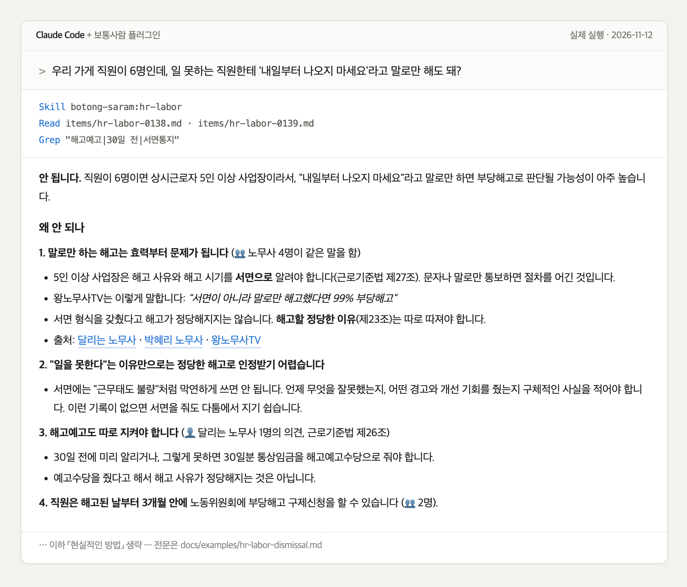
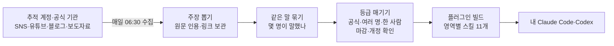

# 보통사람

**요즘 보통사람이라면 이 정도는 알아요.**

업계 인플루언서·실무자·공식 기관이 SNS와 블로그에서 *반복해서 하는 말*을 사람별로 모아, Claude Code·Codex 플러그인으로 매일 배포합니다. 소규모 사업자가 AI에게 마케팅·노무·세무·인허가를 물으면, 답에 **누가, 몇 명이 그렇게 말했는지**와 원문 출처가 함께 붙습니다.

👉 **[플러그인 현황판](https://n7business.github.io/botong-saram/)** — 영역별로 무엇이 실렸는지, 오늘 무엇이 새로 들어왔는지

만든 곳: 강남 역삼동 공유오피스·커뮤니티 **[역삼836](https://yeoksam836.com/?utm_source=github&utm_medium=readme&utm_campaign=botong)** — Claude Code 강의와 만드는 사람들의 모임을 엽니다.



위 화면은 2026-11-12 실제 실행 결과입니다. 답 전문은 [docs/examples/hr-labor-dismissal.md](docs/examples/hr-labor-dismissal.md).

## 설치

**Claude Code**
```
/plugin marketplace add n7business/botong-saram
/plugin install botong-saram@botong-saram
```
`/plugin` → Marketplaces → botong-saram → **Enable auto-update**를 한 번 켜 두면 세션을 열 때마다 새 내용을 받습니다.

**Codex**
```
codex plugin marketplace add n7business/botong-saram
```

설치한 뒤에는 평소처럼 물어보면 됩니다. 예: "직원 6명인데 연장근로수당 꼭 줘야 해?", "스마트스토어 상세페이지 요즘 어떻게 만들어?", "이번 달 마감인 정부지원사업 있어?"

다른 플러그인을 아주 많이 깔아 두었다면 Claude가 보통사람 스킬을 못 고를 때가 있습니다. 그럴 땐 질문 앞에 **"보통사람 기준으로"**를 붙이면 확실히 엽니다.

**그 밖의 에이전트(Cursor·Gemini CLI 등)** — 스킬만 따로 설치: `npx skills add n7business/botong-saram`

### 이 플러그인이 하는 일
- 설치된 마크다운 파일(SKILL.md·all.md·people.md·items/)을 읽기만 합니다. 훅·MCP 서버·실행 스크립트가 없고, 어떤 정보도 밖으로 보내지 않습니다.
- 빌드일이 7일 넘게 지났고 웹을 읽을 수 있으면, 최신본 `raw.githubusercontent.com/n7business/botong-saram/main/plugin/skills/<영역>/SKILL.md`를 읽도록 안내되어 있습니다.

## 들어 있는 것

<!-- stats:start -->
2026-11-14 기준 **3,250건** · 추적 출처 171곳 · 최근 7일 새로 들어온 항목 1,129건 (매일 자동 갱신, ⚖️ 법령 영역)

| 영역 | 항목 | 🏛 공식 | 👥 여러 명 | 👤 한 사람 | 최근 7일 신규 |
|---|--:|--:|--:|--:|--:|
| 마케팅·홍보·디자인 | 638 | 136 | 3 | 499 | 238 |
| 사업화·매출 증대 | 350 | 50 | 3 | 297 | 134 |
| 매출·경영 지표 | 165 | 13 | 2 | 149 | 13 |
| 생산·현장 AX | 172 | 44 | 1 | 127 | 64 |
| 행정·인허가 ⚖️ | 170 | 147 | 0 | 23 | 84 |
| 사업계획서·정부지원 | 402 | 138 | 9 | 255 | 147 |
| AI 도구·트렌드 | 526 | 110 | 17 | 399 | 171 |
| 인사·노무 ⚖️ | 167 | 29 | 20 | 108 | 28 |
| 세무 ⚖️ | 208 | 49 | 5 | 151 | 88 |
| 기본법 ⚖️ | 280 | 133 | 2 | 142 | 106 |
| 창업자 마인드·습관 | 172 | 0 | 1 | 171 | 56 |
<!-- stats:end -->

## 등급 — 검증은 문턱이 아니라 표시입니다

모든 항목을 싣되, 누가 몇 명이 말했는지를 붙입니다. AI는 등급에 맞춰 말투를 바꿉니다.

| 등급 | 뜻 | AI가 전하는 방식 |
|---|---|---|
| 🏛 공식 발표 · 📚 연구·저서 | 정부·공공기관 발표, 법령, 책·논문 | 그대로 따른다 |
| 👥 N명이 말함 | 서로 다른 사람 2명 이상이 같은 말을 함 | "업계에서 보통 이렇게 한다" |
| 👤 한 사람이 말함 | 아직 한 사람만 말함 | "○○는 이렇게 말한다" |
| 🧪 실험 중 | 직접 검증하는 중 | 가설로 전한다 |
| ⚠️ 다시 확인 필요 | 법 개정·다른 주장과 충돌·재검토 기한 경과 | 먼저 경고한다 |
| ⛔ 하지 말 것 | 낡았거나 틀린 것으로 확인됨 | 하지 말라고 말한다 |

신청 마감이 지난 공고는 자동으로 빠집니다. 노무·세무·인허가·기본법 영역은 법령 개정을 주 1회 대조하며, 개별 사안은 전문가 확인이 필요합니다.

## 어떻게 만들어지나



## 역삼836에서 같이 배워요

보통사람은 역삼836이 만들고 매일 운영합니다. 플러그인을 써 보고 더 깊이 배우고 싶다면:
- **[클로드코드 종합 강의](https://yeoksam836.com/courses/claude-code?utm_source=github&utm_medium=readme&utm_campaign=botong)** — 클로드코드를 업무 도구로 제대로 쓰는 방법을 처음부터 끝까지
- **[836 커뮤니티](https://yeoksam836.com/courses/community?utm_source=github&utm_medium=readme&utm_campaign=botong)** — 만드는 사람들이 모여 사례를 나누고 일감과 동료를 찾습니다
- **[공간 둘러보기](https://yeoksam836.com/?utm_source=github&utm_medium=readme&utm_campaign=botong)** — 강남 역삼동 2층 오피스·3층 다목적홀

## 기고자 모집

**각 영역에서 보통 사람에게 주기적으로 지식을 업데이트해 주실 능력자분을 찾습니다.** → [docs/contributors.md](docs/contributors.md)

## 원작자 삭제 요청
보통사람에 내 글이나 계정이 실려 있는데 빼고 싶으시면 계정 주소만 알려 주세요. 확인 후 바로 수집 대상에서 빼고 관련 항목을 모두 지웁니다.
- 이메일: founder@yeoksam836.com
- GitHub 이슈: https://github.com/n7business/botong-saram/issues/new?template=takedown.md

보통사람은 원문 일부를 출처 링크와 함께 짧게 인용합니다. CC-BY-4.0은 보통사람이 쓴 정리·구성에만 적용되며, 인용된 원문의 권리는 원작자에게 있습니다.

---
설계 [docs/vision.md](docs/vision.md) · 영역 [docs/domains.md](docs/domains.md) · 만든 곳 [역삼836](https://yeoksam836.com/?utm_source=github&utm_medium=readme&utm_campaign=botong) · 시작 2026-11-03
