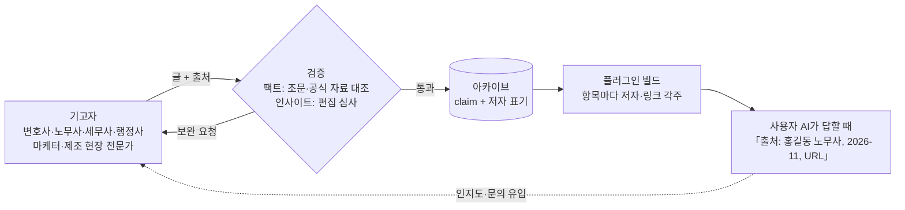

# 능력자를 찾습니다 — 보통사람 기고자 안내

> **각 영역에서 보통 사람에게 주기적으로 지식을 업데이트해 주실 능력자분을 찾습니다.**
> 당신이 쓰고, 우리가 팩트를 검증해 Claude Code 플러그인으로 배포합니다. 플러그인을 쓰는 모든 사람의 AI가 당신의 이름과 글을 인용합니다.

## 어떻게 돌아가나

상부상조 구조: 기고자는 집필에 집중하고, 배포·검증·갱신 알림은 우리가 맡는다. 플러그인 사용자는 항목을 볼 때마다 저자를 본다.

## 모시는 분
- 영역: 마케팅·홍보·디자인 / 사업화·매출 / 경영 지표 / 생산·현장 AX / 행정·인허가 / 사업계획서·정부지원 / AI 도구 / 인사·노무 / 세무 / 기본법 (docs/domains.md)
- **법·노무·세무·인허가 영역은 자격자만**: 변호사·노무사·세무사·행정사(등록번호 확인). 자격 없는 분의 법률·세무 글은 받지 않는다.
- 다른 영역은 자격 대신 실적으로: 본인 채널·사업에서 결과를 낸 기록(수치·기간)을 보여줄 수 있는 분.

## 기준 두 가지 — 둘 다 충족해야 한다
1. **정확한 팩트.** 모든 주장에 출처(URL·날짜). 법·세무는 조문·예규·판례 번호까지. 검증에서 하나라도 틀리면 그 글 전체를 보류한다.
2. **뛰어난 인사이트.** 검색하면 나오는 요약은 안 받는다. "보통사람이 이걸 모르면 돈·시간을 잃는다"가 분명한 글, 흔한 오해를 바로잡는 글, 현장에서만 알 수 있는 판단 기준.

## 절차
1. yeoksam836.com 문의 폼으로 연락 (영역·자격 또는 실적·샘플 글 1편 링크)
2. 샘플 글 검증 → 1주 내 회신
3. 승인 시 주기 약속: 영역별 월 1~4편, 본인 글의 개정·변경 발생 시 갱신 책임(우리가 개정 감시 알림을 보낸다)
4. 글은 claim 스키마(docs/vision.md)로 변환해 아카이브 등록, 저자 표기 고정
5. 매주 플러그인 빌드·배포, CHANGELOG에 저자별 변경 기록

## 기고자가 얻는 것
- 플러그인 SKILL 항목마다 `[출처: 이름(자격), 날짜, 링크]` 각주 — AI가 답할 때 그대로 노출
- yeoksam836.com 「보통사람」 페이지 영역별 기고자 소개(프로필·연락 링크)
- 갱신 알림: 본인 글이 근거한 법령·정책이 바뀌면 우리가 먼저 알려준다
- 836 커뮤니티 세미나·오피스아워 연사 우선 제안

## 우리가 지키는 것
- 글을 임의로 바꾸지 않는다. 요약·구조화만 하고 원문 링크를 남긴다.
- 틀린 정보가 확인되면 삭제가 아니라 "정정" 이력으로 남기고 저자에게 먼저 알린다.
- 저작권은 저자에게. 인용은 2문장 이내, 나머지는 요약+링크.
