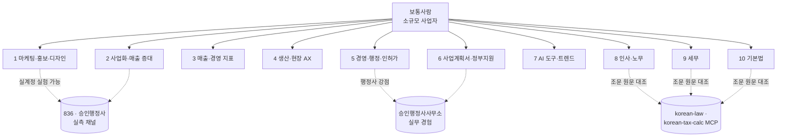

# 영역 지도와 액션 목록

작성 2026-11-03. "보통사람" = 직원 0~10명 사업자·1인 창업자·예비창업자. 이 사람이 AI에게 시켜서 당장 결과를 보는 일만 영역으로 잡는다.

## 영역 11개

| # | 영역 (archive 폴더) | 하위 주제 | 검증 방식 주력 | 재검토 주기 |
|---|---|---|---|---|
| 1 | 마케팅·홍보·디자인 `marketing` | Threads·인스타·유튜브 쇼츠·네이버 블로그/플레이스·브랜드 디자인·메타 광고·카피 | C 실측 (836·승인행정사 계정) + A 플랫폼 정책 | 30~90일 |
| 2 | 사업화·매출 증대 `growth` | 오퍼·가격 설계, 리드 확보(DM·매니챗), 영업 스크립트, 재구매·리텐션, 제휴 | B 교차 + C 실측(836 모객) | 90일 |
| 3 | 매출·경영 지표 `metrics` | KPI 설정, 손익·현금흐름, 단위경제(CAC·LTV·마진), 세무 기초, 가격 인상 판단 | A 공식(국세청·중기부) + B | 180일 |
| 4 | 생산·현장 AX `factory-ax` | 제조 AI 적용 사례, 공정 데이터 수집, 스마트공장 지원사업, 현장 자동화 도구, 재고·품질 | A 공식(스마트제조혁신추진단) + B | 90일 |
| 5 | 행정·인허가 `licensing` | 인허가·법인 설립, 외국인 고용 허가(비자), 보조금 사후관리, 민원 대응 | A 공식(법령·고시) — 행정사 실무로 보강 | 법 개정 시 즉시 |
| 6 | 사업계획서·정부지원 `business-plan` | PSST 구조, 심사위원 관점, 예창패·초창패·바우처 공고 변경, 가점 요소 | A 공식(K-Startup 공고) + B 심사 경험자 | 공고 주기 |
| 7 | AI 도구·트렌드 `ai-tools` | Claude Code·바이브 코딩, 업무 자동화, 도구 신뢰성, 매크로 제재 위험 등 "하지 말 것" | A 공식 문서 + B | 30일 |
| 8 | 인사·노무 `hr-labor` | 채용 공고·근로계약서, 4대보험, 최저임금·주휴·연장수당, 주52시간, 연차, 해고·권고사직, 퇴직금, 취업규칙(10인↑), 프리랜서 vs 근로자 | A 공식(근로기준법·고용노동부 행정해석) | 법 개정 시 즉시, 최저임금 매년 |
| 9 | 세무 `tax` | 사업자 유형(간이·일반·법인) 선택, 부가세·종소세·법인세 신고 일정, 경비 인정·증빙, 세액공제·감면(창업·고용), 원천징수, 홈택스 절차 | A 공식(국세청·세법 조문) + korean-tax-calc로 수치 예시 | 세법 개정 1월·7월 |
| 11 | 창업자 마인드·습관 `mindset` | 인플루언서가 반복해서 강조하는 사장의 원칙·습관·판단 기준 (동기부여 구호 제외). 사업화·지표·마케팅 인플루언서 소스에 `also: [mindset]`로 함께 추출 | B 교차(서로 다른 사람 2명↑) | 365일 |
| 10 | 기본법 `law-basics` | 계약 기본(민법), 상법(법인·주주), 전자상거래법·약관, 개인정보보호법, 표시광고법·공정거래, 하도급, 상표·저작권, 내용증명·소액 분쟁 | A 공식(법령·판례) + 행정사 실무 | 법 개정 시 즉시 |

기존 vision.md의 `management`·`trend`·`threads`·`instagram`은 위 체계로 흡수한다(threads·instagram → marketing 하위 태그, management → licensing+metrics, trend → ai-tools).

### 법·세무 영역(5·8·9·10) 특별 규칙
- **출처는 자격자만.** 변호사·노무사·세무사·행정사가 직접 운영하는 채널과 공식 기관만 sources.yaml에 올린다. 항목에 `license`(자격·등록 확인 URL)가 없으면 수집기가 건너뛴다. 자격 없는 인플루언서의 법률·세무 글은 참고용 inbox에도 넣지 않는다.
- **verified는 조문 근거(A)만.** 노무사·세무사·변호사 채널(B)은 조문과 대조돼야 승격하고, 대조 실패면 candidate로 남긴다. 교차 2곳이어도 조문 없이는 안 올린다.
- 각 항목에 `law_ref`(법령명·조·항, 시행일)를 필수로 둔다. korean-law MCP로 원문을 확인하고 `search_law_bulk`로 월 1회 개정 감시 → 개정되면 자동 stale.
- 세무 수치(세율·공제 한도·신고 기한)는 korean-tax-calc 결과를 그대로 인용하고 직접 계산하지 않는다.
- SKILL.md에 **"이 항목은 일반 정보이며 개별 사안은 전문가 확인"** 문구를 영역 헤더에 고정한다(행정사·세무사법 저촉 방지).
- 시행일 기준 분기: 개정 전후가 다른 항목은 `effective_from`으로 두 버전을 모두 남긴다(사건 시점별 적용 법령이 다름).

## 출처 규칙 (예외 없음)
- 모든 claim은 `sources[]`에 url·author·seen(날짜)·quote(원문 1~2문장)를 가진다. URL 없는 항목은 추출 단계에서 버린다.
- 플러그인 SKILL.md는 항목마다 `[출처: 저자, 날짜, URL]` 각주를 붙인다. 원문은 인용 2문장 이내, 나머지는 요약(저작권).
- 실측(C) 항목은 출처가 "836 실험 YYYY-MM-DD, 지표 전/후 수치"다. 수치 없이 verified 불가.
- 출처 자체의 신뢰도는 sources.yaml `weight`로 관리하고, 틀린 정보를 낸 출처는 weight를 내린다(이력 기록).

## 개정 감시가 "돌고 있는지" 확인하는 구조
법·세무 지식은 갱신 자체보다 **갱신이 멈춘 걸 모르는 것**이 위험하다. 그래서 세 겹으로 둔다.

| 겹 | 무엇 | 주기 | 실패하면 |
|---|---|---|---|
| 1 | `search_law_bulk`로 archive의 모든 `law_ref` 개정 여부 조회 → 개정 시 stale + 저자 알림 | 매주 월 06:00 (맥미니 launchd) | 텔레그램 실패 알림 |
| 2 | 고용노동부·국세청·기재부·공정위·개인정보위 공지 페이지 수집(Aside) → 새 공지를 관련 영역 candidate로 | 매일 | 동상 |
| 3 | **감시 자체의 생존 확인**: 각 잡이 마지막 성공 시각을 `state/heartbeat.json`에 기록, 48시간 넘게 갱신이 없으면 별도 잡이 경보. 플러그인 SKILL 헤더에 `last_law_check` 날짜를 찍어 사용자도 보게 한다 | 매일 | 경보 + 플러그인 헤더에 「확인 지연」 표기 |

정기 이벤트는 캘린더로 고정한다: 최저임금 고시(8월), 세법 개정안(7월)·국회 통과(12월)·시행(1월), 4대보험 요율(연초), 정부지원사업 공고(1~2월).

## 영역별 액션 (내가 할 수 있는 것)

공통 파이프라인 액션 (영역 무관, 1회 구축)
- P1 소스 발굴: 영역별 공식 채널 + 전문가·인플루언서 후보 10개씩 조사해 sources.yaml 초안. 선정 근거(팔로워·게시 빈도·전문성 신호)를 같이 적는다.
- P2 수집기: 맥미니 launchd + `aside exec`로 매일 sources.yaml 순회 → inbox/ 저장(원문·URL·날짜·스크린샷).
- P3 추출기: inbox → claim md. 출처 필드 누락 시 폐기. 중복·충돌 탐지.
- P4 검증기: 영역별 A/B/C 규칙 적용, weight 합산, 자동 승격, review_by 도래 시 재확인.
- P5 빌더: archive → plugin/skills/<영역>/SKILL.md + CHANGELOG. 각주 자동 생성.
- P6 배포: GitHub 공개 마켓플레이스 + yeoksam836.com 상단 「보통사람」 페이지(설치 한 줄·이번 주 바뀐 지식).
- P7 알림: 주간 다이제스트 텔레그램(신규·강등·폐기 목록), 수집 실패 알림.
- P8 기존 플러그인 감사: 지금 설치된 marketing-skills·claude-seo 등 GitHub 플러그인의 주장도 같은 스키마로 넣어 유효성을 점검한다. "유명 플러그인인데 낡은 지식"이 첫 콘텐츠가 될 수 있다.

영역 1 마케팅·홍보·디자인
- 메타 비즈니스 도움말·네이버 서치어드바이저·유튜브 정책 페이지를 A 소스로 등록하고 변경 감시.
- 836 스레드(u4)·승인행정사 블로그/플레이스 채널 트래킹을 C 실험 지표로 연결(이미 GA4·플레이스 통계 수집 중).
- 실험 설계: 후보 claim 1건당 2주 A/B(예: 답글 체인 vs 단일 글). 결과를 observed 항목으로 기록.
- "하지 말 것" 선점: 매크로 발행·AI 대량 생성 블로그·팔로우 품앗이 등 제재 사례를 공식 공지+사례로 묶어 deprecated 항목화.

영역 2 사업화·매출 증대
- 오퍼·가격·리드 확보 전문가 채널 조사(국내 Threads·유튜브 + 해외 뉴스레터).
- 836 모객(고정석·커뮤니티) 자체를 실험장으로: 가격 표기·CTA·DM 스크립트 변형을 측정해 observed 항목 생산.
- 국내 소상공인 매출 데이터(소상공인시장진흥공단·통계청)를 A 소스로 두고 "요즘 평균" 수치 항목 유지.

영역 3 매출·경영 지표
- 국세청·중기부·신용보증기금 공식 자료로 지표 정의 항목 작성(마진·현금흐름·손익분기).
- 클로브(clobe) MCP가 연결돼 있으므로 836·승인행정사 실제 장부로 지표 계산 예시를 만들어 "숫자가 붙은" SKILL 제공.
- 세법 개정은 korean-law MCP로 분기 1회 자동 재확인 → review_by 자동 갱신.

영역 4 생산·현장 AX
- 스마트제조혁신추진단·중기부 스마트공장 공고, 제조 AI 사례집(KAIST·생산기술연구원)을 A 소스로 등록.
- 제조 현장 유튜버·컨설턴트 채널 조사. 이 영역은 실측 채널이 없으므로 B 교차 기준을 3곳으로 올린다.
- "어떤 공정부터 AI를 넣는가" 의사결정 트리를 SKILL로 제공(근거 사례 각주).

영역 5 행정·인허가
- 법령·고시는 korean-law MCP로 원문 확인 후 항목화, 개정 감시를 `search_law_bulk`로 월 1회.
- 승인행정사사무소 실무(인허가·외국인 고용 허가·법인 설립)를 observed 항목으로 전환 — 이 영역이 다른 플러그인에 없는 차별점.

영역 8 인사·노무
- 근로기준법·최저임금법·근로자퇴직급여보장법 조문과 고용노동부 행정해석·질의회시를 A 소스로 등록. 최저임금 고시는 매년 8월 자동 갱신.
- 노무사 유튜브·블로그 10곳 조사(B). "프리랜서 계약인데 근로자로 판정" 같은 분쟁 사례는 판례를 출처로.
- SKILL 산출물: 근로계약서 체크리스트, 4대보험 가입 기준표, 연장·야간·휴일 수당 계산 예시(수치는 고용노동부 계산기 결과 인용).
- 외국인 근로자 고용은 영역 5(비자)와 8(노무) 양쪽에 태그.

영역 9 세무
- 국세청 공지·세법 조문·국세법령정보시스템 예규를 A 소스로. 세법 개정안은 기재부 보도자료(7월)·국회 통과(12월) 감시.
- 세무사 채널 10곳 조사(B). 절세 "팁"은 조문·예규 대조 통과한 것만 승격.
- korean-tax-calc MCP로 간이 vs 일반, 창업 감면, 고용 세액공제 수치 예시 생성 → 출처는 도구 결과+근거 조문.
- 클로브 연동으로 836·승인행정사 실제 신고 일정을 캘린더형 항목으로 제공.

영역 10 기본법
- 민법(계약)·상법(법인)·전자상거래법·개인정보보호법·표시광고법·저작권법 핵심 조문을 A 소스로, 공정위·개인정보위 가이드라인 변경 감시.
- 보통사람이 실제로 부딪히는 순서로 구성: 계약서 쓰기 → 약관·개인정보 처리방침 → 광고 문구 규제 → 상표 → 분쟁(내용증명·지급명령). korean-certified-mail 스킬과 연결.
- 변호사·법무사 채널 조사(B), 판례는 korean-law `search_decisions`로 출처 확정.

영역 6 사업계획서·정부지원
- K-Startup·기업마당 공고 RSS/페이지 감시 → 양식·배점 변경 즉시 항목 갱신.
- 심사위원·합격자 공개 후기 채널 조사(B), 공고문(A)과 대조해 "가점 요소" 항목 유지.
- 기존 AX허브 사업계획서 작성 경험을 PSST 템플릿 SKILL로 정리.

영역 7 AI 도구·트렌드
- Anthropic·Claude Code 공식 문서 변경 감시(A), 바이브 코딩 전문가 채널(B).
- 도구 신뢰성 항목: "이 도구는 이런 상황에서 틀린다"를 사례 각주와 함께 유지.
- 이 영역은 30일 재검토. 지나면 자동 stale.

## 실행 순서 제안
1. P1 소스 발굴 (영역 10개 × 10개, 3일) → 민서 확인
2. P2~P5 파이프라인 (마케팅 영역 1개로 끝까지 관통, 1주)
3. P8 기존 플러그인 감사 → 첫 CHANGELOG 콘텐츠
4. 법·세무 영역(5·8·9·10)은 korean-law·korean-tax-calc 연동 검증기부터 → 나머지 영역 소스 투입, P6 사이트 메뉴
