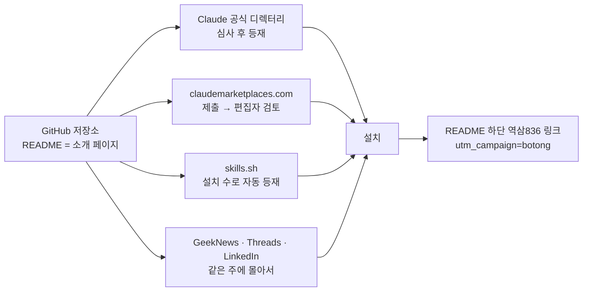

# 등록처 제출 준비 (2026-11-12)

보통사람 플러그인을 사람들이 플러그인을 찾는 곳에 올리기 위한 점검 결과와 제출 문구. 실제 제출은 사용자(민서)가 직접 하거나, 제출 직전에 다시 확인받는다.

## 1. Claude 공식 플러그인 디렉터리
- 제출: https://claude.ai/directory/manage → Submit new → **Plugin bundle** → 저장소 `n7business/botong-saram`, 플러그인 폴더 `plugin` → **Validate** → 문제 없으면 Submit.
- 조건: 유료 Claude 플랜 사용자만 제출 가능. 자동 검사 + 보안 스캔 + 사람 심사.
- 로컬 검사 `claude plugin validate ./plugin`: **통과(경고 2)**
  - `version` 없음 — 일부러 비움(커밋 기준 자동 업데이트). 경고일 뿐 제출 가능.
  - **아이콘 없음** — 512~2048px 정사각 PNG를 `plugin/.claude-plugin/icon.png`에 둔다. **처음 제출할 때 한 번만 등록되고 나중에 못 바꾼다** → 제출 전에 확정 필요.
- 예상 보류(거절 아님, 심사자가 읽음):
  - 플러그인 파일 수 2,900여 개 > 512개 → 「Files … the validator couldn't inspect」 보류. 항목 상세(items/)를 파일 하나씩 둔 구조 때문.
  - 다른 사람 글 인용 — 디렉터리 정책 검토 대상. 출처 링크·짧은 인용·삭제 요청 창구(README·이슈 템플릿)를 갖춰 둠.
- 보안 스캔 대비: 플러그인이 읽기만 하고 아무것도 보내지 않으며, 7일 지나면 raw.githubusercontent.com 최신본을 읽는다는 사실을 README와 plugin/README.md에 적어 둠.

### 디렉터리 소개 문구
- 이름: botong-saram (보통사람)
- 한 줄(영문): Korean small-business know-how from industry practitioners, experts and government sources — every item tagged with who said it, how many people agree, and a source link. Updated daily.
- 한 줄(한글): 업계 실무자·전문가·공식 기관이 반복해서 하는 말을 사람별로 모은 소규모 사업자 지식. 항목마다 누가, 몇 명이 말했는지와 출처가 붙고 매일 갱신됩니다.
- 분야: 마케팅·사업화·지표·제조AX·인허가·사업계획서·AI도구·노무·세무·기본법·창업자 마인드 (스킬 11개)

## 2. claudemarketplaces.com
- 제출: https://claudemarketplaces.com/submit — 편집자가 수동 검토, 설치 수·스타 수로 순위.
- 마켓플레이스 주소: `n7business/botong-saram`, 설치: `/plugin marketplace add n7business/botong-saram`
- 소개 문구는 위 디렉터리 문구 재사용.

## 3. skills.sh
- 제출 절차 없음. `npx skills add n7business/botong-saram`로 설치될 때마다 익명 집계되어 순위가 생긴다.
- 우리 스킬은 `plugin/skills/` 아래라 루트 `skills.sh.json`에 경로를 적어 둠.

## 4. 국내 채널 (같은 주에 몰아서)
- GeekNews Show GN: 제목 예 「Show GN: 보통사람 – 업계 사람들이 반복해서 하는 말을 모은 Claude Code 플러그인」. 본문은 만든 이유(AI 답에 '누가 말했나'가 없음) → 어떻게(매일 수집·등급) → 설치 2줄 → 현황판 링크.
- Threads·LinkedIn: README 맨 위 답변 예시 이미지(docs/assets/example-answer.png) + 설치 2줄.
- 인용된 사람들에게 알릴지는 따로 결정(알리면 공유가 크게 늘 수 있지만 삭제 요청도 올 수 있음).

## 재는 것
- GitHub 방문·클론·유입 경로·스타: `scripts/traffic.py`가 매일 `state/traffic.json`에 쌓고, 주간 텔레그램 다이제스트에 한 줄.
- 역삼836 유입: README의 역삼836 링크는 모두 `utm_source=github&utm_medium=readme&utm_campaign=botong` → 역삼836 GA에서 확인.
