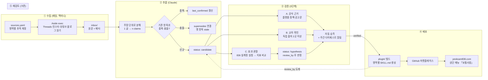

# 보통사람 — 살아있는 지식 아카이브 → Claude Code 플러그인

작성 2026-11-03 · 기획 강민서

## 한 줄 정의
전문가·인플루언서가 매일 올리는 정보를 수집해 **검증된 지식만** 아카이브에 쌓고, 그 아카이브를 **Claude Code 플러그인**으로 빌드해 역삼836 홈페이지에서 배포한다.
메시지: "요즘 보통사람이라면 이 정도는 알아요. 이 플러그인을 Claude Code에 전달하면 알아서 설치됩니다."

## 왜 단순 아카이브가 아닌가
지식은 유효기간이 있다. 작년 마케팅 기법이 올해는 역효과일 수 있다(예: 블로그에 Aside로 매크로처럼 올리면 제재 위험).
그래서 모든 지식 항목은 **상태·근거·재검토일**을 가진 "주장(claim)" 단위로 관리하고, 새 정보가 들어오면 옛 항목을 대체·폐기한다.

## 다루는 영역 (초기 5개)
| 폴더 | 영역 | 비고 |
|---|---|---|
| archive/marketing 외 10개 | 영역 상세는 docs/domains.md | — |

영역은 폴더 추가만으로 늘린다(소장 작성, SEO, 블로그 등).

## 전체 흐름



## 지식 항목 스키마 (archive/<영역>/<id>.md)

```yaml
---
id: threads-0012
domain: threads
claim: "본문을 답글 체인으로 쪼개 올리면 도달이 늘어난다"
status: candidate      # candidate → verified | hypothesis | stale | deprecated
evidence: consensus    # policy(공식) | consensus(교차) | observed(실측) | anecdote(단일)
confidence: 0.7
sources:
  - url: https://www.threads.net/@.../post/...
    author: "@..."
    seen: 2026-11-03
first_seen: 2026-11-03
last_confirmed: 2026-11-03
review_by: 2027-02-03  # trend 30일, SNS 90일, 경영·사업계획서 180일
supersedes: threads-0004
superseded_by: null
experiment: null       # hypothesis일 때 실험 계획·측정 지표
law_ref: null          # 법·세무 영역 필수: {law: 근로기준법, article: 제17조, effective: 2025-01-01}
contributor: null      # 기고자: {name, license: 노무사 제00000호, profile_url} — SKILL 각주에 그대로 표기
---
무엇을 / 어떻게 / 주의점. 플러그인 SKILL.md에 그대로 들어갈 문장으로 쓴다.
```

상태 전이 규칙
- candidate: 추출 직후. 플러그인에 **포함 안 됨**.
- verified: A 또는 B 통과 + 주간 게이트 승인. 플러그인 포함.
- hypothesis: 즉시 검증 불가. 836 실계정 실험을 걸고 review_by에 지표로 판정.
- stale: review_by 지났는데 재확인 실패, 또는 충돌 항목 등장. 플러그인에서 "주의" 표기로 강등.
- deprecated: 반증 확인. 플러그인에 **"하지 말 것"**으로 남긴다(삭제하지 않음 — 옛 지식을 쓰는 AI를 막는 게 목적).

## 검증 정책 (핵심 설계 결정)
1. 즉시 검증 가능한 것과 아닌 것을 구분한다. 플랫폼 정책·공고문은 A, 다수 전문가가 독립적으로 말하면 B, "해보니 됐다"류는 C.
2. C(효과 관찰)는 836·승인행정사 실계정에서 실험한다. 이미 돌고 있는 채널 트래킹(GA4·플레이스·스레드 지표)을 그대로 쓴다.
3. **사람 게이트 없음(11/3 민서 결정).** A·B 통과 시 자동 verified → 다음 빌드에 포함. 대신 주간 다이제스트를 텔레그램으로 보내 민서가 사후 거부(deprecate 명령)할 수 있게 한다.
4. **검증은 문턱이 아니라 등급(11/4 민서 결정).** 모든 주장을 사실 검증할 수는 없다. 보통 사람들이 반복해서 하는 말이 쌓이면 그게 '보통사람'이다. 그래서 플러그인에는 merged를 뺀 모든 주장을 넣고 🏛 공식 발표 > 👥 N명이 말함 > 👤 한 사람이 말함 · ⚠️ 다시 확인 · ⛔ 하지 말 것으로 표시한다. 가장 정확한 건 해당 매체(공식)의 말이지만 그것만으로는 부족하고, 방법을 알려주는 건 결국 사람들이다. 법·세무·노무는 자격자 글만 받는 규칙을 그대로 둔다.
5. **사용자 쪽 자동 갱신.** 플러그인 version을 비워 Claude Code가 git 커밋으로 새 버전을 판단(하루 여러 번 빌드해도 전달). Claude Code는 사용자가 /plugin에서 자동 업데이트를 한 번 켜야 함(외부 마켓플레이스 기본값 꺼짐). Codex는 `.claude-plugin` 형식을 그대로 읽지만 자동 업데이트가 없어, 각 SKILL.md에 '빌드일보다 7일 넘으면 GitHub 최신본을 먼저 읽어라'를 넣는다.
   게이트가 없으므로 B의 기준을 엄격히: 독립 출처 2곳 이상 **그리고** weight 합 ≥ 1.5(공식 1곳이면 단독 통과).
4. 단일 출처(anecdote)는 verified가 될 수 없다. 두 번째 독립 출처가 나올 때까지 candidate.

## 플러그인 형태
```
plugin/
  .claude-plugin/plugin.json      # name: botong-saram, version = 빌드 날짜
  skills/marketing/SKILL.md        # archive/marketing의 verified+deprecated에서 자동 생성
  skills/growth/SKILL.md
  skills/metrics/SKILL.md ... (10개 영역, docs/domains.md)
  ...
  CHANGELOG.md                     # 이번 주 추가·강등·폐기 목록
```
- SKILL.md는 손으로 쓰지 않는다. `archive/ → build → plugin/` 한 방향.
- 사용자는 한 번 설치 후 `claude plugin update`로 최신 지식을 받는다.
- 각 SKILL.md 상단에 `last_built`, 항목마다 `confidence`·`review_by`를 표기해 AI가 불확실성을 알고 쓰게 한다.

## 기고자(능력자) 모집
각 영역에서 보통 사람에게 주기적으로 지식을 업데이트해 주실 능력자를 찾는다. 기고자가 쓰고 우리가 검증·배포하며, 플러그인 항목마다 저자가 표기된다. 기준은 정확한 팩트와 뛰어난 인사이트 둘 다. 상세는 docs/contributors.md.

## 인프라
- 수집·크론: 맥미니 launchd (이미 com.yeoksam836.weekly 운영 중) + Aside CLI(`aside exec`, 프로필 u0).
- 저장: 이 git 레포가 단일 진실. DB 없음. 검색이 필요해지면 SQLite 인덱스를 빌드 산출물로 추가.
- 알림: 주간 다이제스트 → 텔레그램(@builderminseo), 실패 알림은 기존 approval-alert 방식.

## 미결 사항 (민서 결정 필요)
1. 영역별 추적 계정 목록(sources.yaml) — 영역당 5~10개 시작.
2. EgoLite 역할 — 이 맥에는 없음. 맥미니에 있으면 Aside와 역할 분담 정의.

## 확정 (2026-11-03)
- 승격 게이트: 없음. 자동 승격 + 주간 다이제스트 사후 거부권.
- 공개 범위: GitHub 공개 마켓플레이스. 설치 한 줄 `claude plugin marketplace add <org>/botong-saram`.
